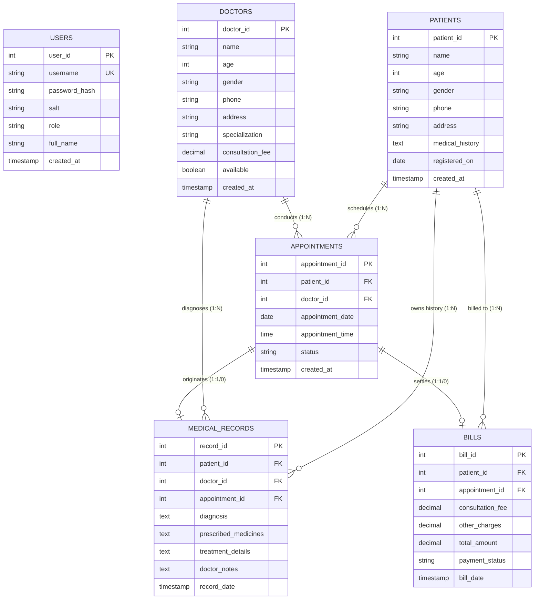

# Entity-Relationship (ER) Diagram & Database Architecture

This document describes the relational database schema for the **Hospital Management System** implemented in MySQL 8.x using the `hospital_management` database.

---

## 1. Visual Entity-Relationship Diagram (Mermaid)

---

## 2. Relational Schema & Cardinality Details

### 1. `patients`
- **Primary Key**: `patient_id` (INT, Auto-Increment)
- **Attributes**: `name` (VARCHAR), `age` (INT), `gender` (VARCHAR), `phone` (VARCHAR), `address` (VARCHAR), `medical_history` (TEXT), `registered_on` (DATE)
- **Integrity**: `CHECK (age >= 0 AND age <= 125)`, `CHECK (gender IN ('Male', 'Female', 'Other'))`
- **Relationships**:
  - `1 : N` with `appointments` (One patient may have multiple consultations).
  - `1 : N` with `medical_records` (One patient accumulates a historical clinical dossier).
  - `1 : N` with `bills` (One patient receives multiple itemized invoices).

### 2. `doctors`
- **Primary Key**: `doctor_id` (INT, Auto-Increment)
- **Attributes**: `name` (VARCHAR), `age` (INT), `gender` (VARCHAR), `phone` (VARCHAR), `address` (VARCHAR), `specialization` (VARCHAR), `consultation_fee` (DECIMAL(10,2)), `available` (TINYINT/BOOLEAN)
- **Integrity**: `CHECK (age >= 21 AND age <= 100)`, `CHECK (consultation_fee >= 0.00)`
- **Relationships**:
  - `1 : N` with `appointments` (One doctor attends to multiple scheduled slots).
  - `1 : N` with `medical_records` (One doctor authors multiple clinical entries).

### 3. `appointments`
- **Primary Key**: `appointment_id` (INT, Auto-Increment)
- **Foreign Keys**:
  - `patient_id` -> references `patients(patient_id)` (`ON DELETE RESTRICT`)
  - `doctor_id` -> references `doctors(doctor_id)` (`ON DELETE RESTRICT`)
- **Key Composite Constraint**:
  - `UNIQUE (doctor_id, appointment_date, appointment_time)`: **Database-level guarantee preventing double booking** for the same doctor at the same moment in time.
- **Integrity**: `CHECK (status IN ('Scheduled', 'Completed', 'Cancelled'))`

### 4. `medical_records`
- **Primary Key**: `record_id` (INT, Auto-Increment)
- **Foreign Keys**:
  - `patient_id` -> references `patients(patient_id)` (`ON DELETE RESTRICT`)
  - `doctor_id` -> references `doctors(doctor_id)` (`ON DELETE RESTRICT`)
  - `appointment_id` -> references `appointments(appointment_id)` (`ON DELETE SET NULL`)
- **Attributes**: `diagnosis` (TEXT NOT NULL), `prescribed_medicines` (TEXT), `treatment_details` (TEXT), `doctor_notes` (TEXT), `record_date` (TIMESTAMP)

### 5. `bills`
- **Primary Key**: `bill_id` (INT, Auto-Increment)
- **Foreign Keys**:
  - `patient_id` -> references `patients(patient_id)` (`ON DELETE RESTRICT`)
  - `appointment_id` -> references `appointments(appointment_id)` (`ON DELETE SET NULL`)
- **Attributes**: `consultation_fee` (DECIMAL(10,2)), `other_charges` (DECIMAL(10,2)), `total_amount` (DECIMAL(10,2)), `payment_status` (VARCHAR - 'Paid', 'Pending')
- **Integrity**: `CHECK (payment_status IN ('Paid', 'Pending'))`, `CHECK (total_amount >= 0.00)`

### 6. `users`
- **Primary Key**: `user_id` (INT, Auto-Increment)
- **Attributes**: `username` (VARCHAR UNIQUE), `password_hash` (VARCHAR 128), `salt` (VARCHAR 64), `role` (VARCHAR), `full_name` (VARCHAR)
- **Integrity**: `CHECK (role IN ('ADMIN', 'RECEPTIONIST'))`

---

## 3. Referential Integrity & Cascade Rules

1. **Why `ON DELETE RESTRICT` for Patients and Doctors?**
   - In a clinical environment, patient medical history and doctor records must never be silently wiped out if related appointments, legal bills, or clinical notes exist.
   - Deleting a patient or doctor is blocked at both the database level (`RESTRICT`) and the service level (`hasActiveReferences()` check), giving the user a friendly warning message instead of corrupting historical data.

2. **Why `ON DELETE SET NULL` for Appointments in Records & Bills?**
   - If an appointment booking entry is purged, the underlying clinical medical note and financial bill must remain intact for audit and legal accountability, simply with the appointment reference set to NULL.

3. **Performance Optimization (Indexes)**:
   - `idx_patients_name` & `idx_patients_phone`: Accelerates quick OPD lookups.
   - `idx_doctors_specialization`: Enables rapid specialty filtering in appointment queues.
   - `idx_appointments_date`: Speeds up daily queue generation for the dashboard.
   - `idx_bills_status`: Optimizes retrieval of outstanding pending accounts.
